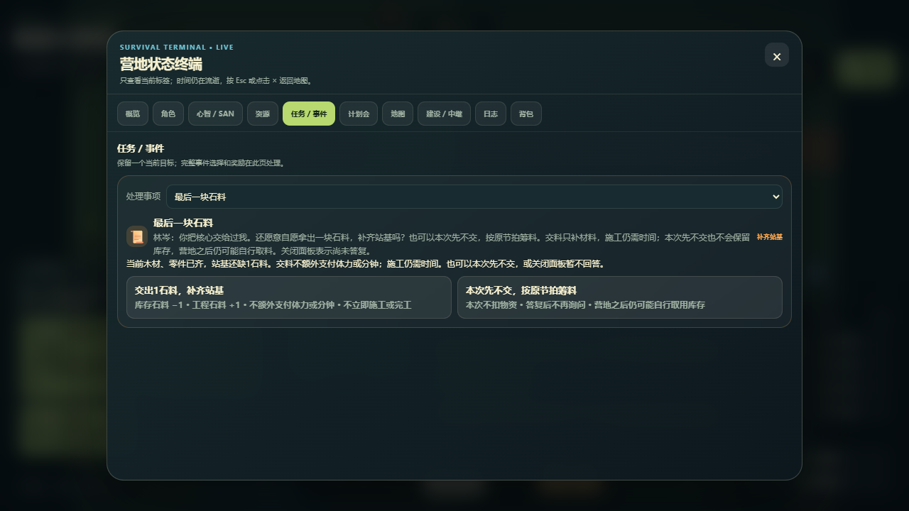

# 桌面操作与选择说明：本轮验收

当前主主题是正常界面下可理解的真实后果。本轮只改善电脑端附近操作和事件答复的阅读条件；手机端优化按用户要求暂停。未增加剧本、奖励、规则或存档字段，也未重做SAVE21/C1/C2。

源码对象为[2970d9b](https://github.com/yzhai4/zombie_harvest/commit/2970d9b3c24e00e677880c39de9ed6e4639ae91d)，父018e70a；最终HTML SHA256 `86ca99869d174f56287309229cd36017ef69aa92122809c62dd998c16497446f`，1,020,086字节。相对082e仅增加7行min-width:900px CSS，style之后的markup/脚本逐字节相同，SAVE21/CONTENT3不变。当前文件记录已发生的本地验收；同步后的CI须按实际head核验，不预填成功。

## 玩家可见变化

附近操作及事件选择的费用说明由8px增至12px，按钮正文10px增至13px，标题12px增至14px，说明9/10px增至12px；按钮保至少48px高度。绿色/攻击按钮的费用文字继承其深色正文，修正灰字在亮色背景上难辨认的问题。未改变两项答复的含义，延期仍不锁定后续自治库存。

## 实际验证与边界

| 检查 | 真实结果 | 不能推定 |
|---|---|---|
| 正常桌面新局短操作 | 1440×900；4次移动后找到等候入口，普通点击60分钟、取消、正常writer、reload/Continue；5.873秒、6次UI操作，HP100；实际结算2分钟，started/stopped均1 | 不是中继全链、自然三日或真人试玩 |
| 恢复后的时钟 | 公开时钟06:03→06:04；当时writer仍为第363分钟，未重复等候收据 | 不能声称新分钟已持久化 |
| 林岑选择桌面呈现 | 1440×900、1280×720、1024×768；两项答复均完整可见、中心可命中、普通点击成功；错误0，全部自有浏览器/服务回收 | 使用既有TEST-ONLY近距/有限库存档，不能证明自然发现邀请 |
| 受控答复后果 | 1440交料：库存1→0、工程3→4；1280/1024延期：库存1、工程3，实际content.chain.resolved各含对应答复 | 不等于施工完成、工程上线或策略价值成立 |
| 现有required合同 | 54/20/21/5/30/19/55，各自全过；合计204；另content71、night guard、inline语法通过 | static三日只是原生static-contract，replay19是fixture数 |
| 既有episode浏览器 | 最终86ca实际12/12，原生旧writer fixture、reload与去重通过 | 不能替代林岑正常路线或完整旧档兼容 |

[当前manifest](iteration-manifest-v1.json)保46项源码依赖和8份本轮原生报告；此前manifest原件见[历史快照](evidence/desktop-readability-v1/history/iteration-manifest-before.json)。本地无.git时commitVerification保持unavailable；Git来源与祖先关系由提交后的同head CI校验。

[选中归档及游戏构建](evidence/desktop-readability-v1/review-bundle.zip)与[逐项索引](evidence/desktop-readability-v1/review-bundle-index.json)集中保存32项工件，已读回核验，不称所有历史的完整导出。归档包含受控writer，不作自然玩法起点；build目录是正常游戏。旧24文件试玩载体/协议/归档批次仍冻结在本地，不随本轮继续上传。

## 方法修正与审查

082e独立桌面短检查已能点击等候，但固定1.1秒不足以证明恢复后新分钟；原记录保留。另一次90秒视觉探查只到找到临时营地，截止关闭后后续调用报页面已关，不算成功点击或自然进展；没有重开A08。此前手机检查只确认60分钟按钮可由正常滚动显示，不证明它是裁切阻断，未改手机代码。

中间1a6的布局/点击通过，但截图发现绿色按钮费用灰字对比不足；最终86ca修色后重新按实际字节验。第一次截图方法等待了不存在的事件类型，超时被局部忽略；实际writer仍有正确content.chain.resolved，旧报告保留，最终方法改为核真实chainId/choiceId后实际通过。验证编排另有启动前语法错误和已退出PID查询方法错误，均无产品检查失败；没有把这些方法异常算成游戏成功。

DeepSeek仅审查有限CSS片段和差分，实际`deepseek-v4.1-flash`，input6455/output537 tokens，费用未知、请求下界1、exit0且回收；指出1024双栏和事项选择器高度风险，主代理已看最终截图。答复超500汉字要求，记格式偏差，未为缩字重发；意见属于中间候选，不是最终验收。未证明总体token/费用节省比例。

六视角：玩家更容易读到当前代价，但可理解性仍待真人验证；NPC知识、记忆和劳动未改；营地有限资源及施工条件未改；势力关系无新增利益；敌人和危险继续原规则；全局命令、事件、保存及自治节拍未改。排版不会令邀请窗口永久保留。

## 唯一下一交付

审核后，在电脑正常界面下检查玩家能否自然遇到林岑邀请、理解提前交料/延期，并区分交料、施工、上线。复用已有理解问题，记录帮助与误解；不另立研究平台。原A08保持80/80关闭，未证明的正常全链、真人反馈与表达收益继续开放；main未合并、生产未部署。按用户要求本轮交付报告后暂停。
