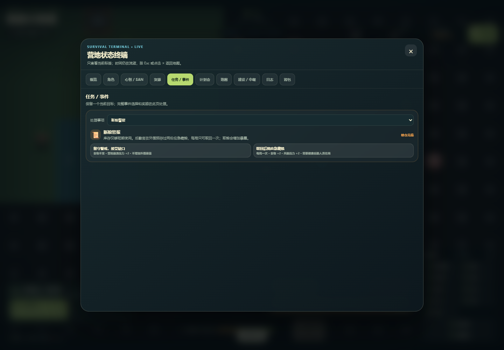

# Episode / Observer 开发候选验收（2026-10-17）

本轮将深度调研作为设计输入，完成一个可验证的缺粮事件切片，并修正其存档、重复执行与表达边界。GitHub 开发线仍是 `codex/v82-npc-succession` / draft PR #4；生产 Sites 保持 v81，本报告不是部署后验收。

来源代码提交：`17925e1c908beb710c6bcb210e20389355805bb8`。最终 `dist/index.html` SHA-256：`cc900da9cdf865b101c37080eb7417148a8a388796ba808153c905ef8ad8494a`。原始调研文件 SHA：`940efac9a98227db2b4512771e474c8366b629d50d72d8e912923d83e2cf06ee`；报告内论文数字和不可解析的旧会话引用没有被本轮重新核验，不作为游戏结果证据。

## 实现与合理性

- repeatable 内容链新增创建日实例身份、五元 CAS 与 SAVE21 加性迁移；旧按钮不能结算新日事件，未知显式版本在安装旧档前拒绝。choice / fallback / autonomy 效果与历史指向同一实例，自动结算原 token 重试不重复发奖。
- 断粮事件的两份食物来自整局一次的后勤应急藏粮，取回增加共振压力；健康在岗后勤或既有健康继任者可执行。留守路线不声称降低配给。玩家、营地、NPC、势力、敌人、全局链的逐项审查见[设计卡](../scripts/zh-food-shortage-001.md)。
- Observer 的 Node 与内嵌纯核心相同，哈希规则统一；未知数字保持未知，未披露事实不从旁路 projection 泄露，输出深冻结。评论开关不再被简洁 HUD 开关意外改变。它仍是确定性表达 stub；未接模型，也未完成 actor/perception 权限体系。

## 实际结果

| 验证范围 | 结果 | 能支持的结论 |
| --- | --- | --- |
| 注册链真实源码 / CommandBus | 54/54；轨迹 golden `c5d6c772` | 本合同覆盖的旧链效果、回滚、恢复未漂移 |
| Inline / Node Gate parity | 20/20 | 共享夹具范围内含健康后勤、继任与粮食条件的输出一致 |
| Observer 纯核心 | 21/21 | 白名单、深冻结、未知值、披露与 UTF-16 哈希合同 |
| 实际源码竖切片 | 5/5 | 中继、源码三日、缺粮、观察者只读与岗位前置；不是浏览器自然三日 |
| Episode 真实 loader / reducer / producer / 菜单 | 30/30 | 完整旧 writer、跨日 stale、未知版本、原身份日志、自动结算重试、藏粮守恒、事务回滚和旧完成档的新 episode 可见性 |
| 保存投影 self-test | 18 个 fixture；golden `4aec7a31` | 保存投影稳定；计数单位不是 18 条内部断言 |
| 三日 static fallback | 55/55 | 静态合同；Python browser 不可用时没有把 fallback 计为自然游玩 |
| 真实 Chrome 155.0.8059.80 | 12/12；页面错误 0 | 旧 writer boot → 公开选择 → 保存 → reload → 继续；两份 HTTP 文档均为上述 SHA |
| Evidence validator 方法自测 | 76/76 | 缺证、pending、旧 hash、报告计数、路径逃逸、缺 runner、错误提交/祖先关系不能伪过 |

此外，本地既有 30 条检查命令全部 exit0，包含昼夜、保存恢复、指挥/维修、leader harness、白天伤害与中继回归；原退出记录随报告保存。一次重复使用输出路径被 runner 的“必须是新报告”保护拒绝，随后在全新输出重跑通过；未放宽该保护。

原始工件在 [runs/episode-observer-20261017-menu](runs/episode-observer-20261017-menu/)。[严格 manifest](iteration-manifest-v1.json)绑定来源提交、HTML、runner/fixture 与原报告 SHA；CI 使用完整 Git 历史，核来源是 HEAD 祖先并逐个校验声明的 `scripts/**` / `dist/**` 字节。CI 结果应读取当前 PR head 的 Actions，不把此前绿色 run 填成本轮结果。归档本地没有 `.git`，本地检查器明确报告 `commitVerification=unavailable`；真实 Git 证明由当前 Actions 的 `--require-git` 执行。

旧 `fff09e89` 候选及 CI #281 按其实际范围保留在原 runs 目录；它们没有覆盖旧一次性完成历史对新菜单的影响。发现后新增真实 renderer 回归，修复并重跑源码与原 Chrome 场景；详情见[问题记录](../problems/PROB-20261017-legacy-episode-menu.md)。新旧原始工件分别保存，76 项检查器方法自测实现未变，保留同一原始方法报告；该报告不声称重新游玩。

## 未完成与下一闸门

没有本构建自然三日 browser、平衡或主线全通结论；历史 strict-fresh 失败保留。Scenario JSON 仍是最小 headless validator/resolver，真实 boot loader、深层图验证与 actor 信息权限未完成。当前已实现的表达边界不等于 EventFact 长期记忆或完整 NPC 自治。

留守额外增加两点崩溃压力，暂不处理保留待办，存在局部激励不对称；原有配给、NPC 需求与低粮战斗后果仍照常。公开 UI 没有显性跳过；切换/关闭面板不触发内部 ifSkipped，只有窗口过期自动 ledger-only。当前仅确认状态、来源、幂等、迁移和回放正确，未宣称立即留守、取粮与先补粮策略已平衡。

下一轮优先以同一构建执行自然三日、事件后果与立即选择/延后补粮的激励验收，同时完成 Scenario boot 与旧档配置兼容、actor/perception 信息投影；随后扩展规则 NPC planning、EventFact 记忆与受约束表达实验。依据调研 P0–P6，反事实规划先用精确 simulator，World Model / 生成式 Director / 全自治社会仍需独立收益 Gate。

本轮新增 ADR、六视角剧本卡及 QA，更新 current-state / open-risks / roadmap / iteration-workflow 与项目 Skill；旧检查点保留并标历史。没有修改系统 memories。
