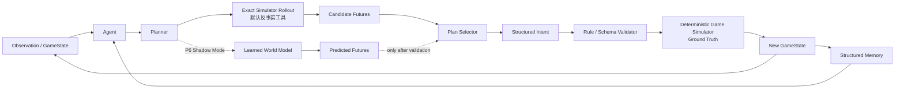
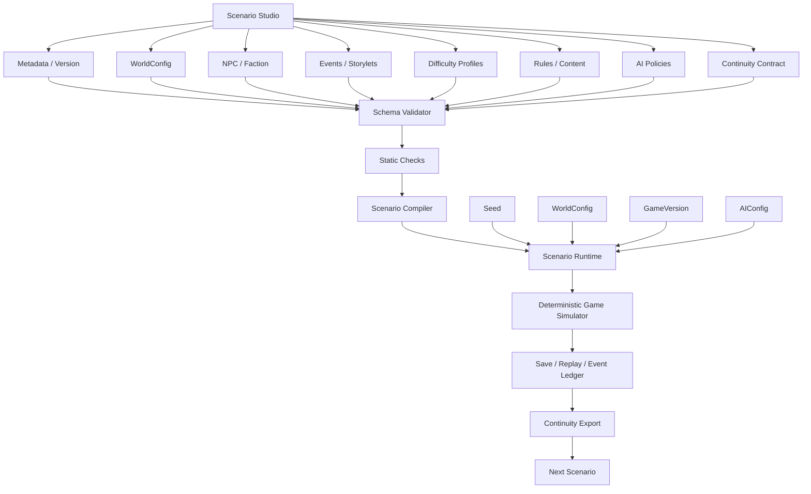
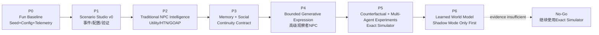

# 《我是救世主》/《尸潮农场》AI 与游戏设计可行性深度调研报告

**研究截止时间：2026 年 10 月 16 日（Asia/Singapore）**

## 执行摘要与前提校验

本轮调研首先纠正一个容易导致项目走偏的前提：

> **《尸潮农场》当前 Demo 不能被当成未来产品形态，也不能因为当前世界规模较小，就据此判断 World Model、多 Agent、跨副本连续性等能力“没有必要”。**

当前仓库本身也明确把项目描述为 Web/Canvas 规则验证平台：现有规则层包括 `state`、命令总线、事件账本、NPC 需求/关系、资源/建筑、昼夜时钟、尸潮结算和存档迁移，并要求这些部分保持确定性；将来迁移引擎时主要替换地图、相机、精灵、输入、音频和资源适配层，而不是重写规则核心。fileciteturn5file0L2-L2 当前计划同时明确指出，已有 `EVENT_CHAIN_DEFS`、`NPC_STORY_DEFS`、`FACTION_DEFS`、`NPC_ROLE_DEFS` 等内容基础设施，但当前 UI 和自治系统仍有大量未完成部分，不能把已有扩展接口误认为完整自治系统。fileciteturn6file0L2-L2

因此，本报告的真正研究对象是：

> **未来《我是救世主》如何构建“玩家面对一个会记住、会反应、会形成后果的世界”，以及《尸潮农场》作为第一个副本应该验证哪些游戏机制与 AI 假设。**

### 核心结论

**[已确认｜高证据] AI 本身不等于可玩性。**  
2026 年 AI-native game 综述在分析 53 个公开游戏/原型后明确指出，运行时生成 AI 本身既不保证“AI-native”，也不保证游戏可玩；真正稳定游戏体验仍依赖目标、规则、状态、反馈、节奏和玩家 agency 等“机械不变量”。citeturn23academia8 与此同时，一项针对玩家 enjoyment 的系统综述与 meta-analysis 甚至发现，很多直觉上“肯定更好玩”的设计变量并没有表现出稳定的显著效应，因此《尸潮农场》的 AI 设计必须依赖玩家实验，而不能从技术能力反推“玩家一定喜欢”。citeturn18search4

**[合理推断｜本报告最重要的设计判断]《我是救世主》近期最值得建设的不是 Learned World Model，而是“Living World Infrastructure”。**

其优先顺序应当是：

\[
\boxed{
\text{可玩核心}
\rightarrow
\text{Seed+Config}
\rightarrow
\text{Scenario Studio}
\rightarrow
\text{NPC Planning}
\rightarrow
\text{Memory/Social}
\rightarrow
\text{受约束生成表达}
\rightarrow
\text{反事实规划}
\rightarrow
\text{Learned World Model}
}
\]

原因是当前项目已经拥有确定性规则模拟器；World Model 真正解决的是“近似/学习环境动力学”或者为 Agent 提供 imagined rollout。在真实 \(F(S,A)\) 已经存在时，首先用精确 simulator rollout 或符号搜索通常比重新训练 \(\hat F(S,A)\) 更可靠。World Model 研究目前也正在从“视频看起来真实”转向“是否真的帮助 Agent 完成任务”：ICLR 2026 的 World-In-World 显示视觉质量本身不能保证任务成功，可控性对闭环 Agent 更关键；2026 年 World Model benchmark survey 也把 functional utility、counterfactual reasoning、long-horizon persistence 等独立出来。citeturn16search3turn16search4turn16search5

**[已确认｜高证据] 当前 LLM NPC 远未成熟到可以取代传统游戏 AI。**  
2026 年 IEEE *Transactions on Games* 的系统 mapping 从 377 篇论文筛出 42 篇深入分析：world-state grounding 为 69%，短期记忆为 60%，但长期记忆只有 31%，reflection 38%，RAG 14%，已报告的响应时间范围达到 2.6–15 秒。citeturn15search0 因而，普通 NPC 的移动、工作、战斗、逃跑、岗位执行等高频行为仍应优先使用规则、Utility、Behavior Tree、GOAP/HTN 等传统 AI；LLM 更适合低频、高层、语义性的角色行为。

**[已确认＋合理推断] “受约束生成式表达”是目前最值得玩家实验验证的生成式 AI 能力。**  
2026 年一项 \(N=72\) 的 2×2 被试内实验发现，动态物品状态和自适应 NPC 对话均显著改善该实验中的 presence、autonomy 和 enjoyment。citeturn18search0 但这项研究并不意味着《我是救世主》应该让 LLM 改变物品真实属性。恰恰相反，你提出的方案更适合本项目：**Ground Truth 永远属于游戏；高级 NPC/“系统”只控制信息披露、解释、评论与角色立场。** 这也与 Ubisoft NEO NPC 的工业实验方向相符——角色背景、目标、人格和 narrative arc 仍由作者定义，模型只在 guardrails 内即兴。citeturn21search0

**[合理推断｜高优先级] 少量跨副本持久 NPC 有潜力成为《我是救世主》的核心差异化能力，但必须实施“连续性预算”。**  
BG3 的官方设计明确让 companions 拥有独立 personality、goals、motivations，并让玩家行为和阵营选择持续改变双方关系，营地交流也会回应当天事件。citeturn20search6turn20search7 这支持“角色记得玩家行为”的设计方向，但 BG3 本身并不能证明“大量跨副本 AI NPC”可控。Dwarf Fortress 的开发者反而提供了一个非常重要的反例：NPC 自治能产生 emergent narrative，但过多 bureaucracy 会让系统变慢、繁琐、混乱且易出 bug，玩家仍需保有对整体方向的控制。citeturn19search3

**[合理推断] 不建议采用生成式 AI Director 作为主线。**  
可以保留**确定性、可 Seed 复现的事件预算/节奏系统**。Left 4 Dead 的经典 Director 设计本身重点是 adaptive dramatic pacing，原始演讲明确区分“调整 pacing frequency”与“直接调整 difficulty amplitude”。citeturn24search4 因此《尸潮农场》完全可以借鉴“高压—缓冲—再次高压”的节奏思想，但无需让生成式模型决定玩家遭遇什么。

### 已知前提、设计假设与未知项

| 项目 | 当前状态 | 证据等级 |
|---|---|---|
| 《尸潮农场》目前是早期 Demo，而非最终产品形态 | 已确认 | **用户输入 + 仓库**；当前确为 Web/Canvas 规则验证平台。fileciteturn5file0L2-L2 |
| 未来会扩大地图、可交互对象、可交互性 | 已确认设计方向 | **用户输入** |
| 《尸潮农场》只是《我是救世主》第一个副本 | 已确认设计方向 | **用户输入** |
| 未来游戏引擎 | **未指定** | Unity/Godot/Unreal 等均未冻结 |
| 最终目标平台 | **未指定** | PC/移动/主机未冻结 |
| 多人/联机 | **未指定** | 当前计划也没有多人持久化。fileciteturn6file0L2-L2 |
| 确定性 Game Simulator 是 Ground Truth | 已确认 | **用户确认 + 当前架构**。fileciteturn5file0L2-L2 |
| AI 不得绕过游戏规则直接修改真实状态 | 已确认设计原则 | **用户确认** |
| 所有生成式 AI 功能必须明确 ON/OFF | 已确认设计原则 | **用户确认** |
| AI OFF 后游戏仍必须正常可玩 | 已确认设计原则 | **用户确认** |
| 高级 NPC 可提供动态评价，但不能修改物品/NPC 实际价值 | 已确认设计原则 | **用户确认** |
| 少量特殊 NPC 可跨副本携带记忆 | 已确认设计方向 | **用户确认** |
| 持久 NPC 最终数量 | **未指定** | 建议通过连续性成本实验决定 |
| World Model 是否最终进入正式产品 | **未知** | 需要 P5/P6 实验 |
| World Model 形式 | **未知** | structured/latent/visual 均未决定 |
| AI 模型供应商、本地模型/API | **未指定** | 不能提前绑死架构 |
| AI 单玩家小时成本预算 | **未指定** | 产品化前必须补 |
| 是否要求完全离线 | **未指定** | 影响模型架构 |
| Scenario Studio / 可复用剧本设置器 | 已确认长期目标 | **用户确认** |
| Seed+Config+GameVersion+AIConfig 复现机制 | 已确认长期目标 | **用户确认** |
| 交付时间 | **未指定** | 因此本报告按 Gate 而非日历排期 |

这与当前仓库已有的方向并不冲突：项目已经有事件账本、回放、内容注册表、事务效果、存档迁移等基础设施，而且现有设计文档已经明确把项目自定义的 14 天、阈值、commandPoints 等标记为“项目假设而非外部作品官方数值”，要求通过后续测试重新校准。fileciteturn6file0L2-L2

## 研究地图与搜索完整性

本轮采用之前确定的 **v0.1 分类树**，但不是把论文按“LLM / World Model”简单分组，而是同时覆盖：

\[
\text{玩家体验}
\leftrightarrow
\text{游戏机制}
\leftrightarrow
\text{NPC/Agent}
\leftrightarrow
\text{World Model}
\leftrightarrow
\text{工程与验证}
\]

中国资料优先的原则被保留，但不以牺牲证据等级为代价。例如国内已有《系统仿真学报》2025 年的智能博弈决策大模型 Agent 综述，覆盖强化学习、博弈树搜索、多实体协调和生成时规划，可作为中文 Agent 技术入口；清华团队也有针对 World Model / Embodied World Model 的系统综述介绍。citeturn24search0turn24search1 但 GameWorld、PlayWorld、AgentWorld、SIMA 2 等 2026 前沿工作尚没有质量相当的中文一手版本，因此本报告直接引用英文原始论文/项目页，并提供中文归纳。

**表 1：研究地图**

| 一级领域 | v0.1 子类 | 研究问题 | 典型搜索词 | 当前覆盖 |
|---|---|---|---|---|
| A 玩家体验 | Agency / Autonomy | 玩家选择是否真实改变世界 | `player agency`, `autonomy` | **强** |
| A 玩家体验 | Enjoyment / Engagement | AI 是否真的更好玩 | `player enjoyment`, `engagement`, `flow` | **强** |
| A 玩家体验 | Immersion / Presence | 世界是否可信、连贯 | `immersion`, `presence`, `believability` | **强** |
| A 玩家体验 | Challenge / Tension | 压力是否合适且可读 | `challenge`, `tension`, `stress curve` | **中强** |
| A 玩家体验 | Legibility | NPC 行为是否能理解/学习 | `AI legibility`, `predictability`, `fairness` | **中** |
| A 玩家体验 | Attachment | 玩家是否在乎 NPC | `companion attachment`, `relatedness` | **中** |
| A 玩家体验 | Replayability | 不同 run 是否值得重复 | `replayability`, `run diversity` | **中** |
| B 游戏系统 | Survival / Resource | 资源约束是否产生有意义取舍 | `survival management`, `scarcity` | **强** |
| B 游戏系统 | Risk / Uncertainty | 有限信息与后果如何设计 | `risk`, `uncertainty`, `consequence` | **强** |
| B 游戏系统 | Emergent Gameplay | 系统组合是否形成意外玩法 | `emergent gameplay` | **强** |
| B 游戏系统 | Emergent Narrative | 非脚本故事如何产生 | `emergent narrative`, `storylet` | **强** |
| B 游戏系统 | Social Simulation | NPC 社会是否持续运转 | `social simulation`, `agent society` | **强** |
| B 游戏系统 | World Simulation | 离屏/远景世界如何结算 | `world simulation`, `metaworld` | **强** |
| B 游戏系统 | Pacing / Director | 如何形成压力峰谷 | `AI director`, `dramatic pacing`, `DDA` | **中强** |
| C NPC | FSM/Utility | 普通 NPC 基础行为 | `utility AI`, `behavior tree` | **强** |
| C NPC | GOAP/HTN/MCTS | 长期规划与重规划 | `GOAP`, `HTN`, `MCTS NPC` | **强** |
| C NPC | Memory | 长期角色连续性 | `NPC memory`, `episodic memory` | **强** |
| C NPC | Personality/Social | 人格、价值观、关系 | `social AI`, `relationship model` | **中强** |
| C NPC | LLM NPC | 开放对话和语义自治 | `LLM NPC`, `generative character` | **强** |
| D Game Agent | Grounding/Action | 如何读取状态并执行 | `game agent`, `semantic action` | **强** |
| D Game Agent | Reasoning/Planning | 高层任务如何完成 | `agent planning`, `long horizon` | **强** |
| D Game Agent | Learning/Memory | 经验和技能如何积累 | `lifelong game agent`, `skill library` | **强** |
| D Game Agent | Multi-Agent | 分工、通信和共享计划 | `multi-agent collaboration` | **强** |
| E World Model | Explicit/Symbolic | 显式世界规则 | `symbolic world model` | **强** |
| E World Model | Model-Based / Latent | 学习状态转移 | `model-based RL`, `latent dynamics` | **强** |
| E World Model | Visual/Interactive | 生成可交互视觉世界 | `interactive world model` | **强** |
| E World Model | Counterfactual | “如果这样做会怎样” | `counterfactual world model` | **强** |
| E World Model | Planner Utility | 预测是否帮助 Agent | `functional utility`, `planning regret` | **强** |
| F 生成系统 | Dialogue / Expression | 动态表达是否有价值 | `adaptive NPC dialogue` | **强** |
| F 生成系统 | Events / Quest | 动态事件是否可控 | `generative quest`, `dynamic events` | **中** |
| F 生成系统 | Narrative | LLM 叙事一致性 | `narrative generation games` | **强** |
| G 评估工程 | Player Study | 怎么证明更好玩 | `GUR`, `player study`, `PXI` | **强** |
| G 评估工程 | State-verifiable | 不靠 LLM Judge 验收 | `state-verifiable evaluation` | **强** |
| G 评估工程 | Reproducibility | 同配置能否复现 | `deterministic replay`, `seed` | **强** |
| G 评估工程 | Latency/Cost | AI 是否跑得动/付得起 | `LLM latency`, `inference cost` | **中强** |
| G 评估工程 | Safety/Control | 偏见、越界、提示注入 | `NPC safety`, `AI bias`, `guardrail` | **中** |
| G 评估工程 | Scenario Authoring | 如何制作大量副本内容 | `scenario editor`, `narrative authoring` | **强** |

**完整搜索矩阵：关键词扩展规则**

| 搜索簇 | 核心词 | 同义词 | 邻近词/防漏词 |
|---|---|---|---|
| 玩家控制 | player agency | autonomy, meaningful choice | consequence, control, freedom |
| 玩家乐趣 | player enjoyment | fun, engagement | flow, satisfaction, continuance |
| 沉浸 | immersion | presence | believability, coherence |
| 紧张 | tension | challenge | pressure, difficulty, stress |
| AI 可读性 | AI legibility | predictability | explainability, fairness |
| NPC 依恋 | companion attachment | relatedness | emotional bond, identity |
| 生存经营 | survival management | colony survival | resource scarcity, attrition |
| 数值平衡 | game economy balance | resource balancing | economy tuning, spreadsheets |
| 风险选择 | risk and uncertainty | ambiguous choice | moral dilemma, wicked problem |
| 涌现玩法 | emergent gameplay | systemic gameplay | sandbox simulation |
| 涌现叙事 | emergent narrative | simulation storytelling | storylet, procedural narrative |
| 社会模拟 | social simulation | NPC society | agent-based simulation |
| 远景模拟 | metaworld | off-screen simulation | abstract simulation, ledger |
| 传统 NPC AI | utility AI | behavior tree, FSM | considerations, scoring |
| 规划 NPC | GOAP | HTN, MCTS | planner, replanning |
| LLM NPC | LLM NPC | generative NPC | AI companion, digital character |
| NPC 记忆 | NPC memory | persistent memory | episodic, semantic, reflection, RAG |
| 人格 | NPC personality | persona | value alignment, consistency |
| 关系 | relationship system | reputation | trust, affinity, faction attitude |
| Game Agent | game agent | gaming agent | embodied agent, computer-use game |
| 长时任务 | long-horizon game agent | lifelong agent | skill library, curriculum |
| 多 Agent | multi-agent game | collaboration | coordination, role allocation |
| World Model | world model | learned simulator | dynamics model, neural simulator |
| Latent WM | latent dynamics | model-based RL | RSSM, imagination |
| 视觉 WM | video world model | generative world model | neural game engine |
| 反事实 | counterfactual planning | what-if | intervention, causal reasoning |
| WM 价值 | planner utility | functional utility | closed-loop success, regret |
| 动态对话 | adaptive dialogue | grounded dialogue | constrained generation |
| 剧本工具 | narrative authoring | scenario editor | storylet, branching narrative |
| 数据驱动 | data-driven gameplay | configuration | DataTable, curves, balance sheet |
| 可复现 | deterministic replay | fixed seed | snapshot, event ledger |
| 评估 | player study | games user research | PXI, BANGS, telemetry |
| AI 性能 | inference latency | cost | on-device, SLM, batching |
| AI 安全 | NPC safety | moderation | bias, jailbreak, prompt injection |

**搜索完整性矩阵初稿**

| 主题 | 状态 | 已有锚点 | 当前仍需补的部分 |
|---|---|---|---|
| Player Agency | ✅ 强 | PXI、BANGS、BG3/Frostpunk | 玩家类型分层 |
| Enjoyment | ✅ 强 | meta-analysis、PXI | 长期留存行为 |
| Immersion/Presence | ✅ 强 | 2026 GenAI 玩家实验 | 非 VR 大规模复现 |
| Challenge/Tension | ◐ | PXI、Darkest Dungeon、DDA | 生存经营专项 |
| Replayability | ◐ | RimWorld、TWoM、L4D | 缺统一量表 |
| Attachment | ◐ | BANGS、BG3、AI Companion | **跨副本长期实验缺口明显** |
| 生存资源经济 | ✅/◐ | TWoM、Frostpunk、Kenshi | 更多定量经济论文 |
| 涌现叙事 | ✅ 强 | RimWorld、DF、PZ、ETH | 玩家是否更喜欢仍需实验 |
| 传统 NPC Planning | ✅ 强 | GOAP/HTN/MCTS | 引擎落地后性能预算 |
| LLM NPC | ✅ 强 | 377→42 mapping | 长时真实商业运行 |
| NPC Memory | ✅/◐ | mapping、Generative Agents | 长期玩家实证不足 |
| Social AI | ◐ | BG3、Generative Agents | 关系模型数值化 |
| Game Agent | ✅ 强 | ACS survey、GameWorld、Voyager | 持续跟踪 benchmark |
| Multi-Agent | ✅ 强 | AgentWorld | **与真人玩家共存研究较少** |
| World Model | ✅ 强 | World-In-World、PlayWorld、Genie | 结构化经营世界 WM 很少 |
| Counterfactual | ✅ 强 | WM benchmark survey | 需要本项目自建 benchmark |
| 生成表达 | ✅ 强 | 2026 玩家实验、Ubisoft | 中国玩家群体 |
| AI Director/DDA | ✅/◐ | L4D、DDA SLR | 已决定不作为生成式主线 |
| Scenario Authoring | ✅ 强 | ink、Yarn、articy、PZ | 目标引擎未冻结 |
| 可复现验证 | ✅ 强 | GameWorld＋当前项目 | CI 工具待实现 |
| 延迟/成本 | ◐ | NPC mapping、NVIDIA ACE | 平台与硬件未指定 |
| Safety/Bias | ◐ | NPC mapping、FairGamer | Prompt injection 威胁模型 |
| Accessibility | ☐ 待检索 | — | 产品化前补 |
| Localization | ☐ 待检索 | — | 产品化前补 |
| Privacy/Legal | ☐ 待检索 | — | AI 服务商/发行区域确定后补 |
| Monetization | ☐ 待检索 | — | 商业模式未指定 |

这里必须明确：**“核心设计研究覆盖较高”不等于“项目所有产品化问题已经搜全”。** 目前对可玩性、NPC、Agent、World Model、Scenario Authoring 的覆盖已经足以决定下一阶段研发优先级，但 accessibility、法律隐私、商业化 AI 成本等仍应保持“未完成”，不能像之前 TextHash 一样把“看过很多论文”误写成“检索闭环”。

## 游戏可玩性与经典设计证据

最大的研究结论不是“哪款游戏可以抄”，而是：**这些经典作品反复出现了一组相似的设计结构，但它们没有证明任何单个结构单独就能导致“好玩”。**

玩家体验量表也支持这一谨慎态度。PXI 经过 64 名 GUR 专家与 529 名玩家验证，包含 Meaning、Mastery、Immersion、Autonomy、Curiosity、Ease of Control、Challenge、Progress Feedback、Audiovisual Appeal、Goals and Rules 十个构念；BANGS 又从 autonomy、competence、relatedness 的满足与挫败两个方向建立了游戏专用量表，并在五项研究、1246 名参与者中验证。citeturn18search2turn18search3

因此，我们真正应该测试的是：

\[
\text{机制变化}
\rightarrow
\text{玩家能否感知}
\rightarrow
\text{是否改变 Agency/Challenge/Attachment}
\rightarrow
\text{是否提高继续游玩的意愿}
\]

而不是：

\[
\text{AI 更复杂}
\Rightarrow
\text{更好玩}
\]

**经典设计案例映射**

| 作品/研究 | 已确认的设计思想 | 对《尸潮农场》的可迁移价值 | 不能直接推出什么 |
|---|---|---|---|
| RimWorld | 开发者明确把作品框定为“story generator”，并据此筛选真正产生 compelling play 的功能。citeturn19search0turn25search8 | 事件/NPC/资源系统应该服务于“能讲出的故事”，而非模拟量越多越好 | 不能证明随机事件越多越好 |
| Dwarf Fortress | 玩家应是“fortress 的官方意志”，矮人仍保持合理自治；开发者承认过多 bureaucracy 会变慢、繁琐、混乱。citeturn19search3 | **玩家定方向，NPC 有人格和局部自主性**；这是《尸潮农场》最重要的平衡 | 不能让全部 NPC 完全自由后只让玩家旁观 |
| Project Zomboid | 离屏 NPC 可用简化 storylet/metaworld 事件驱动；人物、技能、情境改变事件分支，重新进场时再物化结果。citeturn19search5turn19search6 | 与当前“近景实体、远景账本”的路线高度匹配；Scenario Studio 可直接采用 storylet 思想 | 不需要为全地图 NPC 每帧完整模拟 |
| This War of Mine | 使用不同 survivor set、预定义 timeline、冬季/袭击/价格变化等多层随机性；开发者通过大规模表格长期调参，并把不同随机层分开平衡。citeturn20search0 | **参数化世界 + 分层随机 + Seed + 事件时间线**；尤其适合你的自定义开局设计 | 随机性本身不等于重玩性 |
| Frostpunk | 玩家选择与经济、生存和价值观代价耦合；Book of Laws 后来改成玩家可以主动决定何时推进，从而恢复 agency。citeturn20search3turn20search4 | 价值观与生存成本应该形成真实冲突；不能把“善良选项”设计成免费最优解 | 不宜用简单善恶值替代真实代价 |
| Darkest Dungeon | 明确公开 Stress 数值，让玩家能管理风险，同时 Affliction 的具体行为保留有限不可预测性；设计目标之一就是让角色偶尔违背玩家指令。citeturn20search9 | **可读状态 + 有界失控**。NPC 自治不是黑箱，玩家应知道“为什么他可能拒绝” | 不能让 NPC 任意随机拒绝 |
| Kenshi | 官方强调开放世界、队伍、基地、伤势、没有等级缩放，且世界持续移动。citeturn19search1 | 世界可以不围着玩家暂停；探索、生存、建设和伤势处于同一系统 | 不意味着《尸潮农场》需要复制巨大地图 |
| Baldur’s Gate 3 | Companion 有自身 goals/motivations，玩家行为会改变双方关系，角色也对其他角色和阵营有观点，并会回应当天事件。citeturn20search6turn20search7 | 特殊 NPC 应是“有立场的持续角色”，而不只是记聊天记录 | 不能证明大量跨副本 NPC 一定可管理 |
| Left 4 Dead | Director 的经典核心是 dramatic pacing；演讲明确指出调的是压力出现频率，不是单纯把敌人变强。citeturn24search4 | 可以采用**规则化节奏预算**，而无需 Generative Director | 不代表必须让 AI 动态操纵剧情 |

**[合理推断] 对《尸潮农场》而言，最值得形成的核心循环不是“AI NPC 聊天”，而是：**

```text
准备
  ↓
资源与时间约束
  ↓
做出不完美选择
  ↓
尸潮 / 事件 / 探索兑现
  ↓
人物受伤 / 死亡 / 关系变化 / 世界变化
  ↓
角色记住这件事
  ↓
第二天面对新的局面
```

即：

\[
\boxed{
Decision
\rightarrow
Consequence
\rightarrow
Memory
\rightarrow
New\ Decision
}
\]

这种结构同时吸收了 TWoM 的稀缺取舍、Darkest Dungeon 的人物压力、Dwarf Fortress 的自治角色、BG3 的关系反应以及 RimWorld 的 emergent story 思想，但这只是**设计综合推断**，仍然必须经过玩家测试。citeturn20search0turn20search9turn19search3turn20search7turn19search0

**建议建立的核心量化指标**

| 维度 | 主观指标 | 客观 Telemetry |
|---|---|---|
| Enjoyment | PXI/单独 enjoyment | 单次时长、主动继续下一天、主动重开 |
| Agency | PXI Autonomy | 有效选择数量、玩家干预率、选项后果分化率 |
| Challenge/Tension | PXI Challenge | 濒危时长、资源安全天数、伤亡波动 |
| Mastery | PXI Mastery | 决策效率随 run 增长、资源浪费下降 |
| Curiosity | PXI Curiosity | 探索率、支线触发率、未知对象交互率 |
| Attachment | BANGS Relatedness + 自定义角色量表 | 主动对话、救援投入、为了 NPC 牺牲资源 |
| Legibility | 行为可理解评分 | “为什么发生”查询率、误判 NPC 意图次数 |
| Replayability | 重玩意愿 | 二周目启动率、不同策略覆盖 |
| World Reactivity | 自定义量表 | 行为后可观测世界变化数量 |
| AI Trust | AI 内容可信度 | 事实错误、人格矛盾、fallback、关闭 AI 比率 |

**数值设计也不应该只有一个“Difficulty = 1.5×敌人”变量。** 更合理的是把难度拆成独立轴：

\[
Difficulty =
f(
Scarcity,
Threat,
Population,
Recovery,
Information,
TimePressure,
EventDensity
)
\]

这与 TWoM 把多种随机层分开平衡的实践一致，而 2025 年 DDA 系统综述也显示现有方案本来就是 AI、heuristic 和直接参数操作等多条路线并存，没有证据支持必须使用智能 Director。citeturn20search0turn24search2

建议 Scene/WorldConfig 至少能够记录：

```text
population.ordinaryNpcCount
resource.foodDensity
resource.medicineDensity
resource.materialDensity

threat.initialEnemyCount
threat.enemyDensity
threat.waveGrowth
threat.specialEnemyRate

recovery.injuryRecoveryRate
recovery.buildRepairCost

events.frequency
events.branchVariance

world.mapScale
world.poiDensity
```

并配套几个**不直接操纵玩家的诊断指标**：

\[
FoodDays=
\frac{FoodStock}{ExpectedDailyConsumption}
\]

\[
DefenseCoverage=
\frac{ExpectedDefenseCapacity}{ExpectedThreatDemand}
\]

\[
InjuryBurden=
\frac{UnavailableLaborDueToInjury}{TotalAvailableLabor}
\]

这些是**调试与平衡指标，不是 AI Director 的控制权**。

## AI 能力评估与 World Model 专题

**表 2：尸潮农场能力地图**

| 能力 | 想解决的问题 | 玩家价值判断 | 跨副本复用 | 成本/风险 | 推荐 |
|---|---|---|---|---|---|
| Seed+Config+Snapshot | 平衡、调试、复现 | **间接但基础性极高** | 极高 | 低 | **P0** |
| Scenario Studio | 大量副本/事件可持续制作 | **高** | 极高 | 中 | **P1** |
| Utility/HTN/GOAP NPC | 普通 NPC 合理自治 | **高** | 极高 | 中 | **P2** |
| Structured Memory | NPC 记住重要行为 | **潜在高** | 极高 | 中 | **P3** |
| Social/Values Model | 玩家行为改变立场/合作 | **潜在高** | 极高 | 中 | **P3** |
| 少量 Persistent NPC | 跨副本情感连续性 | **潜在很高** | 极高 | 高 | **P3–P4** |
| Bounded Generative Expression | 动态评论、交流、评价 | **有实证前景** | 极高 | 中高 | **P4** |
| Exact Counterfactual Planning | NPC 会比较几个未来 | **潜在高** | 极高 | 中 | **P5** |
| Multi-Agent Society | 分工、协调、冲突 | **未知/可能高** | 高 | 很高 | **P5 研究** |
| Generative Director | 让 AI 改事件/节奏 | **未知且与当前目标冲突** | 中 | 高 | **不进主线** |
| Learned Structured WM | 学习未来、加速/迁移规划 | **未知** | 高 | 很高 | **P6** |
| Visual Generative WM | AI 直接生成游戏世界画面 | 目前低 | 低 | 极高 | **不作为产品主线** |

传统 planning 不是“落后方案”。F.E.A.R. 的 GOAP 工作早已证明实时规划相对于大量硬编码 FSM 的优势在于能动态处理意外状态并复用 goal/action 模块，只是会增加 CPU 成本；HTN 后续也长期用于 NPC 的长时行为，关键工程问题之一就是重规划。citeturn23search2turn23search3 ETH Zurich 的 NPC Engine 则进一步展示了 MCTS、多 Agent、不同持续时间任务、动态角色数量和可调 state-value 等设计，并明确把 designer control 与 emergent narrative 的可控性列为开放问题。citeturn25search0turn25search2

**表 3：候选迭代矩阵**

下面的分数不是“科学测得的效果”，而是本轮证据基础上的**设计先验**：玩家价值权重最高，同时考虑研究价值、跨副本复用、证据强度、成本和风险。

| 能力 | 玩家价值 | 研究价值 | 复用 | 成本 | 风险 | 当前判断 |
|---|---:|---:|---:|---:|---:|---|
| Social / Relationship | 4.6 | 4.0 | 5.0 | 3.0 | 2.5 | **很高** |
| Scenario Studio | 4.5 | 4.0 | 5.0 | 3.0 | 2.0 | **很高** |
| Traditional NPC Planning | 4.5 | 4.0 | 5.0 | 3.0 | 2.5 | **很高** |
| Structured Memory | 4.5 | 4.5 | 5.0 | 3.0 | 3.0 | **高** |
| Bounded Gen Expression | 4.2 | 4.0 | 5.0 | 3.0 | 3.0 | **高** |
| Exact Counterfactual | 4.0 | 4.5 | 5.0 | 3.5 | 2.5 | **中后期高** |
| Persistent Special NPC | 4.5 | 5.0 | 5.0 | 4.0 | 4.0 | **价值高但需控制范围** |
| Multi-Agent Society | 3.5 | 5.0 | 4.0 | 5.0 | 5.0 | **研究后置** |
| Learned WM | 2.5 | 5.0 | 4.0 | 5.0 | 5.0 | **研究后置** |
| Generative Director | 2.0 | 3.5 | 3.0 | 4.0 | 4.5 | **不建议主线** |
| Visual WM | 1.5 | 4.5 | 2.0 | 5.0 | 5.0 | **不建议产品化投入** |


**[已确认] 现在就把每个普通 NPC 都变成 LLM Agent 缺乏研究支持。** 除了前述 LLM NPC 的延迟和长期记忆问题外，2026 年 AgentWorld 将 3–20 个 Agent 放进 50+ round 的 MMORPG 协作任务后，最佳测试模型也只有 52% task success，典型失败包括 communication breakdown、role confusion 和无法长期维持 shared plan。citeturn15search4

因此更合理的是：

```text
普通 NPC
    ↓
Role + Need + Relationship
    ↓
Utility / HTN / GOAP / BT
    ↓
可解释 Intent
    ↓
Game Rules

特殊 NPC
    ↓
Goal + Value + Structured Memory
    ↓
Planner
    ↓
低频 LLM Semantic Layer（可关闭）
    ↓
Intent / Commentary
    ↓
Validator
    ↓
Game Rules
```

**受约束“高级观察者 NPC / 评估系统”应这样设计：**

```text
GameState
   │
   ▼
Ground Truth Extractor
   │
   ▼
Disclosure Policy
   │
   ├─ Relationship
   ├─ Value Alignment
   ├─ NPC Interest
   ├─ Player Progress
   └─ Canonical Rules
   │
   ▼
Allowed Fact Pack
   │
   ├───────────────┐
   ▼               ▼
Authoritative UI   LLM Commentary
真实数据            动态评价/交流
                   │
                   ▼
              Output Validator
                   │
                   ▼
                  UI
```

关键点不是 prompt 写一句“不要泄漏秘密”，而是：

> **[合理推断] 模型根本不应收到当前无权披露的事实。**

例如真实物品状态：

```json
{
  "itemId": "artifact_014",
  "trueValue": 82,
  "hiddenTrait": "faction_core",
  "dangerLevel": 3
}
```

当玩家与高级 NPC 关系不足时，送入 LLM 的上下文应当已经被裁剪成：

```json
{
  "itemId": "artifact_014",
  "allowedFacts": [
    "旧时代遗物",
    "可能具有特殊用途"
  ]
}
```

这样**信息安全位于 Context Construction，而不是寄希望于模型自律。**

AI OFF 时，同一个 `DisclosurePolicy` 继续运行，只是：

```text
LLM Commentary
      ↓
Authored Template Pool
```

因此关闭 AI 不会改变游戏平衡或信息权限。

这一设计也更接近 Ubisoft 当前工业实验的成熟边界：NEO NPC 明确让 writer 决定人物、背景、风格和 narrative arc，再由模型在 guardrails 内即兴；Teammates 后续也仍使用“fences”控制模型在 lore 和 motivation 范围内行动。citeturn21search0turn21search1

### World Model 的真实边界

World Model 不能作为一个单词讨论。

| World Model 用途 | 输入输出 | 对本项目价值 | 当前判断 |
|---|---|---|---|
| Future-state prediction | \(S_t,A_t\rightarrow S_{t+k}\) | NPC 预测后果 | **可能有价值** |
| Counterfactual | 多个 \(A\rightarrow\) 多个未来 | 比较修墙/采集/远征 | **高研究价值** |
| Planner Utility | 用预测结果选 action | 直接影响决策质量 | **最重要验收标准** |
| Agent training | imagined trajectories | 大规模训练 Agent | 后期 |
| Visual world generation | frame+action→frame | 替代/补充视觉环境 | 当前低 |
| Neural game engine | 模型直接模拟游戏 | 替代传统引擎 | **目前不合理** |
| Creator tool | 世界/玩法 prototype | Scenario 设计辅助 | 长期可研究 |

当前前沿 World Model 的能力仍显示明显长时程边界。Genie 3 能以约 20–24 FPS、720p 生成可交互世界，并维持几分钟量级的一致性，但官方同时明确承认 action space、多 Agent 交互以及持续数小时的交互仍是限制。citeturn17search0turn17search1 PlayWorld 进一步用 171 个场景、10–60 秒 rollout 测试长期交互，发现当前模型尤其在空间一致性和持久状态演化方面仍不可靠。citeturn16search1turn16search2

这与《我是救世主》需要的：

> “第一个副本中做出的承诺，数十小时以后第三个副本 NPC 还能正确记住”

显然不是同一个时间尺度。

所以建议的正式架构是：



**[合理推断] World Model 的 Go/No-Go 验收不应该是“生成画面看起来像游戏”，而应该至少包括：**

| 指标 | 含义 |
|---|---|
| \(k\)-step state error | 多步后与真实 Simulator 状态偏差 |
| Event F1 | 是否正确预测事件发生/不发生 |
| Resource Δ MAE | 资源变化预测误差 |
| Invariant violation rate | 是否产生“不可能世界状态” |
| Brier / calibration | 风险概率是否可信 |
| Counterfactual ranking | 是否正确比较 A/B/C 哪个更好 |
| Planning regret | WM Planner 选的行动相比 exact planner 损失多少 |
| Task Success | 最后是不是完成目标 |
| Long-horizon divergence | rollout 越长漂移有多快 |
| Rollouts/sec / latency | 到底有没有性能收益 |
| Cross-scenario transfer | 是否能从尸潮农场迁移到副本 B |

这正符合 2026 年 World Model benchmark 研究正在强调的 functional utility 与 long-horizon persistence，而不是单纯画面 fidelity。citeturn16search3turn16search5

DIAMOND 证明 diffusion world model 确实可以用于 Agent 训练，并在 Atari 100k 上获得较强结果，甚至可以用静态 CS:GO 数据训练交互 neural engine；Microsoft Muse 则展示了 World/Human Action Model 也可以用于**开发者 gameplay ideation**。但这两者分别说明“World Model 可以有这些用途”，并不说明它们适合替代《我是救世主》已经存在的确定性规则系统。citeturn16search6turn16search7turn21search2turn21search5

## Scenario Studio 与跨副本连续性

Scenario Studio 是本轮调研后我认为**与 AI 同等重要、甚至应该先于 AI 建设的基础设施**。

已有 narrative authoring 工具证明，“叙事内容数据化 + 条件 + 变量 + 游戏接口”是成熟路线：ink 支持选择、条件、全局变量、JSON 和 Unity/Unreal 集成；Yarn Spinner 支持变量、commands/functions 和 Unity/Godot；articy:draft 支持 flow、global variables、condition/instruction、simulation 和多引擎导出；Unreal 官方 Data Driven Gameplay 也明确建议把长期运行游戏中的数值参数放入 DataTable/CurveTable 等外部数据层。citeturn22search0turn22search3turn22search8turn22search10

这意味着《我是救世主》的长期基础应是：



**建议 Schema 草案：**

```yaml
scenario:
  id: zombie_harvest
  schemaVersion: 1
  contentVersion: 1

metadata:
  title: "尸潮农场"
  campaign: "im_the_savior"

world:
  generator: zombie_farm_v1
  map:
    sizePreset: standard
  population:
    ordinaryNpcCount: 24
  resources:
    foodMultiplier: 1.0
    medicineMultiplier: 1.0
  threats:
    initialEnemyMultiplier: 1.0
    waveGrowthMultiplier: 1.0

difficulty:
  presets:
    easy: {}
    standard: {}
    hard: {}
  playerCustomizable:
    - world.population.ordinaryNpcCount
    - world.resources.foodMultiplier
    - world.threats.initialEnemyMultiplier

events:
  registry:
    - zh.food_shortage.001
    - zh.wall_breach.001

ai:
  generativeFeaturesDefault: false
  policies:
    observer_commentary:
      authority: expression_only
      fallback: authored_template
    npc_dialogue:
      authority: expression_only

continuity:
  importContracts: []
  exportContracts:
    - observer_core_v1
```

这里的具体数值只是 schema 示例，**不是建议的正式平衡值**。

**事件链应数据化，而不是写成大量 `if day == ...`：**

```yaml
id: zh.food_shortage.001
type: storylet

trigger:
  all:
    - metric: camp.foodDays
      op: "<"
      value: 2
    - metric: day
      op: ">="
      value: 4

guards:
  cooldownDays: 3
  oncePerRun: false

participants:
  requiredRoles:
    - quartermaster

choices:
  - id: ration
    requirements:
      commandPoints: 1
    effects:
      - op: modify
        path: camp.rationLevel
        value: -1
      - op: modify
        path: camp.morale
        value: -5

  - id: forage
    effects:
      - op: createMission
        missionId: forage_emergency

followups:
  ration: zh.ration_consequence.001
  forage: zh.forage_result.001

expression:
  observerCommentary:
    enabled: true
    authority: expression_only
```

Project Zomboid 正在实践的 metaworld/storylet 设计与这一思路高度接近：NPC 离开 streamed-in area 后，不需要做真实寻路和逐僵尸战斗，而是用基于 personality、skills、situation 的简化事件推进，等玩家再次遇到他们时再把结果物化到世界。citeturn19search5turn19search6

### 跨副本连续性 Contract

不建议把“完整聊天 transcript”直接当成 NPC 的长期人格数据库。

更合理的是：

```json
{
  "contractVersion": 1,
  "npcId": "observer_001",

  "relationship": {
    "trust": 0.71,
    "valueAlignment": 0.42,
    "interestAlignment": 0.65
  },

  "canonicalMemories": [
    {
      "eventId": "zh.saved_survivor_jiangfeng",
      "type": "saved_life",
      "playerRole": "rescuer",
      "significance": "major"
    },
    {
      "eventId": "zh.betrayed_faction_south",
      "type": "faction_choice",
      "significance": "major"
    }
  ],

  "commitments": [
    {
      "id": "promise_return_artifact",
      "state": "open"
    }
  ],

  "unresolvedThreads": [
    "observer_questions_player_motive"
  ]
}
```

设计原则是：

\[
\boxed{
LongTermMemory
=
CanonicalFacts
+
RelationshipState
+
Commitments
+
ValueEvidence
}
\]

而不是：

\[
LongTermMemory = 全部聊天记录
\]

LLM 可以从这些事实生成自然语言回忆，但 **LLM summary 只是派生缓存，不是唯一事实源**。

这正好能控制你担心的剧情状态爆炸。

建议角色分层：

| NPC 层级 | 跨副本 | 长期记忆 | LLM表达 | 目标 |
|---|---|---|---|---|
| Ordinary | 否 | 副本内有限 | 默认否 | 让世界运转 |
| Named Local | 通常否 | 副本内重要事件 | 可选 | 本副本角色故事 |
| Persistent Special | 是，少量 | 结构化语义记忆 | 可选 | 跨副本关系 |
| Core Observer | 是，极少 | 深层连续性 | **重点候选** | “系统”/解释世界/持续角色 |

**[未知] 最终应该有几个 Persistent Special NPC。**

我不建议现在冻结数字。实验原型可以从 **1–2 个**开始，但这只是为了控制实验变量，不是最终产品上限。

### Seed + Config 参数快照

```json
{
  "saveId": "ZH-TEST-00142",
  "gameVersion": "0.9.0",
  "scenarioId": "zombie_harvest",
  "scenarioVersion": 12,

  "seed": 381729,

  "worldConfig": {
    "ordinaryNpcCount": 30,
    "foodMultiplier": 0.75,
    "initialEnemyMultiplier": 1.4
  },

  "difficultyProfile": "custom",

  "aiConfig": {
    "generativeDialogue": true,
    "observerCommentary": true,
    "generatedWorldEvents": false,
    "learnedWorldModel": false
  }
}
```

真正可复现应满足：

\[
\boxed{
Seed
+
WorldConfig
+
ScenarioVersion
+
GameVersion
+
AIConfig
\rightarrow
Reproducible\ Ground\ Truth
}
\]

其中生成式文本本身可以不 bitwise deterministic，但其**真实状态结果必须不受文本随机性影响**。

**Scenario Studio 三层界面**

| 层 | 面向谁 | 应暴露什么 |
|---|---|---|
| 玩家新建存档 | 普通玩家 | 简单/标准/困难、自定义 NPC 数、资源量、威胁、事件频率等有限参数 |
| 调试模式 | 设计/QA | Seed 锁定、时间跳转、资源/NPC/敌人生成、触发事件、状态查看、AI 开关、Replay |
| 开发模式 | 程序/系统设计 | Schema、事件图、reference validator、migration、state diff、AI trace、Continuity Contract、性能预算 |

静态检查器至少应检测：

```text
Stable ID collision
Missing references
Unreachable event
Event without fallback
Circular chain without guard
Conflicting state writes
Impossible requirements
Missing localization key
Missing continuity importer/exporter
AI expression touching forbidden authority
No AI-OFF fallback
Save migration incompatibility
```

这样 Scenario Studio 最终才不是“剧情 GUI”，而是：

\[
\boxed{
Content\ Authoring
+
Balance\ Configuration
+
Validation
+
Simulation
+
Replay
}
\]

## 实验矩阵与实施路线

以下实验的样本规模是**规划估计，不是正式 preregistered power analysis**。对于被试内实验，假设我们希望检测大约 \(d=0.4\) 的中小效应、\(\alpha=.05\)、80% power，约 50 名完成参与者是一个合理起点；真正测试前应依据 pilot 方差重新计算。

**可执行实验矩阵**

| 实验 | 假设 | 实现 | 核心指标 | 样本 | Go / No-Go |
|---|---|---|---|---|---|
| **E1 核心循环数值** | 资源×人口×威胁存在“紧张但可控”区域 | AI 全关；同 Seed 因子实验 | PXI Challenge/Autonomy、存活、资源裕度、决策熵 | 12–20 pilot；后续 50+ | 必须找到不靠纯加血量也能提高 tension 的区间 |
| **E2 NPC Planning** | Utility/HTN/GOAP 比简单规则更能形成反应性世界 | FSM vs Planner，成对 Seed | Task success、玩家干预、agency、可读性、卡死率 | ≈50 配对 | ≥0.3SD 目标体验提升或 >60%偏好，且严重错误<1% |
| **E3 Structured Memory** | 结构化事实记忆提高角色连续性 | 无长期记忆 vs EventFact | 事实 recall、false memory、attachment、relatedness | ≈50 配对 | 误记<1%，连续性至少一个主指标提升 |
| **E4 受约束生成表达** | Ground Truth 不变的动态评论仍能增加互动价值 | 固定文本 vs grounded AI | enjoyment、presence、autonomy、事实错误、延迟 | ≈52 配对 | ≥一个核心体验 +0.3SD，事实错误<1%，Goals&Rules 不下降 |
| **E5 跨副本 NPC** | 少量持久角色让玩家觉得“世界记得我” | 两个微型副本，reset vs ContinuityContract | perceived consequence、attachment、矛盾数 | 20–30 pilot；正式约 64/组 | 体验改善且关键剧情冲突可控 |
| **E6 Deterministic Replay** | AI OFF 的 Ground Truth 必须严格可复现 | 1000+ seeds 自动运行 | State hash、event sequence、migration | 无人工样本 | **100% canonical replay 一致** |
| **E7 Exact Counterfactual** | Simulator rollout 能提升高层决策 | heuristic vs exact rollout | 成功率、planning regret、耗时 | ≥500 seeds/条件 | 决策改善且计算预算可接受 |
| **E8 Learned WM Shadow** | Learned WM 只有在保留 planner utility 同时降低成本时才值得 | WM 只影子预测，不改状态 | k-step error、event F1、Brier、task success、regret | ≥1000 unseen seeds | Task Success 距 exact ≤5pp 且获得明确性能/迁移收益 |

E4 特别对应目前最有直接玩家实验证据的方向：2026 的 contextualized GenAI 研究确实观察到了 presence、autonomy 和 enjoyment 的提升。citeturn18search0 但另一项 2026 GenAI NPC 玩家研究也观察到，一旦对话出现不自然、不正确、不一致或没有信息价值的输出，沉浸感会迅速受损。citeturn18search5 因此 E4 的关键验收指标不能只有“玩家觉得新奇”，必须同时量化**事实错误率和人格矛盾率**。

E2 也不能只测“NPC 完成任务率”。2026 年针对 15,412 条商业游戏 AI companion 相关 Steam 评论的研究发现，对于系统型 companion，战斗、协调、生存等**功能可靠性**是正面感知的基础，而情感/叙事整合是在此基础上放大的价值；叙事型 companion 则更依赖 relational depth 和 identity。citeturn25search10 这支持“普通 NPC 先保证有用，特殊 NPC 再追求深层关系”的分层路线。

### P0–P6 路线



| 阶段 | 必须交付 | 验收 Gate |
|---|---|---|
| **P0** | Seed/Config/Snapshot、Telemetry、PXI/BANGS 测试框架、AI 总开关 | 核心状态可复现；能回答“当前好不好玩” |
| **P1** | Scenario Schema、Event Graph、Validator、自定义开局 | 新内容无需修改核心状态机即可注册 |
| **P2** | Ordinary NPC baseline、Planner trace、可读行动原因 | 比 FSM 提升行为质量且不削弱玩家控制 |
| **P3** | EventFact Memory、Relationship/Values、Continuity Contract | 无严重 false memory；跨存档/副本可迁移 |
| **P4** | Observer NPC、DisclosurePolicy、Grounded Generation、Fallback | AI OFF 完整可玩；AI ON 有体验收益且事实可靠 |
| **P5** | Simulator counterfactual API、Multi-Agent sandbox | 证明未来推演本身提高决策价值 |
| **P6** | Structured/Latent WM shadow benchmark | **必须击败/补足 exact rollout，不能因为热门而上线** |

这里有一个重要的 **Stop Rule**：

> **P5 如果已经能用精确 Simulator rollout 在合理成本下完成规划，就没有产品理由必须进入 P6。**

这不是“World Model 失败”，而是正确的工程决策。

GameWorld 给我们的最重要启发也是这种验收思想：它不依赖 LLM-as-judge，而是直接从游戏序列化状态判断成功和 progress，目前覆盖 34 个浏览器游戏、170 个任务。citeturn15search2turn15search3 《尸潮农场》已经有确定性状态与事件账本，因此完全适合建立自己的 **state-verifiable Agent benchmark**。fileciteturn5file0L2-L2

## 论文卡片、检索方法与最终建议

本轮方法采用：

```text
Anchor Survey
    ↓
Taxonomy Expansion
    ↓
Keyword Matrix
    ↓
Backward Citation Chaining
    ↓
Forward / 2026 Benchmark Search
    ↓
Official Project / GitHub / GDC Verification
    ↓
Player Study Cross-check
    ↓
尸潮农场机制映射
```

数据源优先级实际采用：

1. **同行评审 systematic review / meta-analysis / controlled player study**
2. **顶会/期刊论文与官方 benchmark**
3. **大学/研究机构官方项目页**
4. **游戏开发者/GDC/开发商一手资料**
5. **官方游戏文档与 engine documentation**
6. GitHub / 开源实现
7. 社区 Wiki 与二手报道仅补充，不作为关键结论唯一依据

这一原则也与当前《尸潮农场》仓库自己的证据记录方式一致：已有文档明确划分开发者/发行商一手资料、官方商店/开发者维护资料和社区二手资料，并规定外部游戏只能作为机制方向证据，不能直接拿其数值当本项目平衡参数。fileciteturn7file0L2-L2

**核心论文/项目卡片摘要**

| ID | 文献/项目 | 核心问题 | 关键结果 | 对项目关系 | 证据 |
|---|---|---|---|---|---|
| P01 | LLM-Based NPCs Systematic Mapping | LLM NPC 到底发展到哪 | 377→42；长期记忆31%；延迟2.6–15s | **Direct** | citeturn15search0 |
| P02 | LLM Game Agent Survey | Game Agent 架构 | Memory/Reasoning/Perception-Action + Multi-Agent | **Direct** | citeturn15search1 |
| P03 | GameWorld | 如何严格评价 Game Agent | 34 games/170 tasks/state-verifiable | **Direct** | citeturn15search3 |
| P04 | AgentWorld | 长时多 Agent 协作 | 3–20 agents；最佳 task success 52% | **Direct** | citeturn15search4 |
| P05 | PlayWorld | WM 长时交互是否一致 | 171 cases；当前模型 persistent state 仍弱 | **Adaptable** | citeturn16search1turn16search2 |
| P06 | World-In-World | WM 是否真帮助 Agent | 画质≠成功，可控性/闭环任务更重要 | **Direct** | citeturn16search4turn16search5 |
| P07 | DIAMOND | diffusion WM 能否训练 Agent | Atari 100k 强结果；可形成 neural engine | Inspiration | citeturn16search7 |
| P08 | Voyager | 长期 Game Agent | curriculum + skill library + environment feedback | Adaptable | citeturn17academia4 |
| P09 | Generative Agents | 记忆/反思/规划与社会行为 | 25 Agents 形成涌现社交 | Adaptable | citeturn17search3 |
| P10 | Contextualized GenAI Player Study | AI 集成是否改善体验 | N=72；presence/autonomy/enjoyment 提升 | **Direct** | citeturn18search0 |
| P11 | Narrative/Dialog Mapping | 生成叙事常见失败是什么 | 55 studies；一致性、重复、memory、latency | **Direct** | citeturn23search0turn23search1 |
| P12 | AI Native Games Survey | AI 与可玩性的关系 | 53 cases；generation 不等于 playability | **Direct** | citeturn23academia8 |
| P13 | GOAP / F.E.A.R. | NPC 实时规划 | 可适应意外、模块化，但耗 CPU | **Direct baseline** | citeturn23search2 |
| P14 | Advanced HTN | 长时 NPC 行为 | HTN 成熟但 replanning 是核心工程问题 | **Direct baseline** | citeturn23search3 |
| P15 | ETH NPC Engine | Planning→Emergent Narrative | MCTS + lightweight agents 可形成协作/竞争行为 | **Direct research** | citeturn25search0turn25search2 |
| P16 | Genie 3 | Interactive visual WM | 20–24fps/720p，但时长和 multi-agent 有限制 | Contrast | citeturn17search0 |
| P17 | SIMA 2 | 跨世界 generalist agent | 推理与泛化进步；长时任务和短 memory 仍是问题 | Inspiration | citeturn17search2 |
| P18 | Microsoft Muse | WM 创作工具 | WM 可用于 gameplay ideation | Inspiration | citeturn21search2turn21search5 |
| I01 | Ubisoft NEO NPC | 工业 GenAI NPC | Writer-defined character + guardrail + improvisation | **Direct industrial** | citeturn21search0 |
| I02 | Ubisoft Teammates | GenAI 进入真实 gameplay | NPC/assistant 有世界上下文，但仍受 fences 约束 | Direct industrial | citeturn21search1 |
| I03 | NVIDIA ACE | 实时 Agent 工程 | perception/cognition/action/memory、on-device SLM | Engineering | citeturn21search3turn21search4 |
| G01 | RimWorld | Story generator | 系统服务故事而非堆功能 | **Design anchor** | citeturn19search0 |
| G02 | Project Zomboid | Off-screen NPC/world | storylet + abstract simulation | **Architecture anchor** | citeturn19search5turn19search6 |
| G03 | This War of Mine | 生存数值/随机层 | survivor/timeline/randomness 分层平衡 | **Balance anchor** | citeturn20search0 |
| G04 | Darkest Dungeon | Autonomous character pressure | clear meter + bounded unpredictable behavior | **NPC agency anchor** | citeturn20search9 |
| G05 | BG3 | Reactive companion | personality/goals/relations react to player | **Persistent NPC anchor** | citeturn20search6turn20search7 |

完整 Paper Card 已按此前约定字段整理为 CSV，包括 `Problem / Game Type / Agent Type / World Representation / Memory / Planning / World Model / Evaluation / Result / Limitations / Relevance / Hypothesis / Replication`：

[下载完整论文卡片 CSV](sandbox:/mnt/data/wssz_paper_cards.csv)

同时已把本报告的研究地图、能力地图、候选迭代矩阵、论文卡片、实验矩阵与搜索完整性矩阵整理成一个可继续维护的工作簿：

[下载《我是救世主》AI 与游戏设计研究工作簿](sandbox:/mnt/data/wssz_ai_game_design_research_workbook.xlsx)

[下载优先级条形图](sandbox:/mnt/data/wssz_priority_chart.png)

**最终建议可以浓缩成七条。**

**第一，[已确认] 游戏先于 AI。**  
下一阶段最需要证明的仍然是“准备—选择—尸潮/事件兑现—后果—下一轮”本身是否好玩。AI-native games 的最新综述与 enjoyment meta-analysis 都不支持“AI 功能更多自然更有趣”的假设。citeturn23academia8turn18search4

**第二，[合理推断] 让世界会反应，而不是让 LLM 接管世界。**

最值得成为长期设计核心的仍然是我们前面形成的这句话：

> **AI 让游戏世界中的其他主体拥有足够的目标、记忆、关系和有限预测能力，使玩家的选择真正面对一个会反应的世界。**

但其中“目标、记忆、关系”优先于“语言模型”，“有限预测”优先从真实 Simulator rollout 开始。

**第三，[合理推断] 普通 NPC 与特殊 NPC 必须分层。**  
普通 NPC 首先要求功能可靠、低成本、可解释；角色型特殊 NPC 才值得投入长期记忆、价值观和生成式表达。商业 companion 玩家研究也支持“功能能力是系统型 companion 的基础，关系深度则是叙事型角色的额外价值”。citeturn25search10

**第四，[合理推断] 你提出的“高级 NPC + 万物评价系统”是当前最合理的生成式 AI MVP。**  
因为它把 AI 放在：

\[
\boxed{\text{Interpretation Layer}}
\]

而不是：

\[
\boxed{\text{Truth Layer}}
\]

玩家行为可以改变 NPC 愿意告诉你多少、用什么态度解释、如何评论，但**不能改变物品的真实攻击力、NPC 的真实能力或游戏规则**。这既保留互动性，也天然支持 AI ON/OFF。

**第五，[合理推断] 跨副本连续性的最小单位应该是 EventFact，而不是聊天记录。**

例如：

```text
saved_npc_X
betrayed_faction_Y
kept_promise_Z
sacrificed_resources_for_civilians
repeatedly_chose_utilitarian_actions
```

这些事实再驱动：

```text
Relationship
Values
Information Disclosure
Dialogue
Future Decisions
```

它比“把完整对话历史塞给 LLM”更可验证、更便宜，也更适合多年迭代。

**第六，[已确认设计方向] Scenario Studio + Seed/Config 应尽早成为共通基础设施。**  
因为《尸潮农场》不是唯一副本。等第二个副本才抽象 Scenario 层，极可能付出更高迁移成本。成熟 narrative/data-driven 工具已经证明 variables、conditions、commands、simulation、external data 等机制的可行性。citeturn22search0turn22search3turn22search8turn22search10

建议工程交付最终至少拆成：

```text
scenario-schema/
scenario-validator/
scenario-runtime/
event-graph/
world-config/
difficulty-presets/
seed-replay/
state-verifier/
npc-planner/
npc-memory/
relationship-model/
continuity-contract/
ai-feature-flags/
ground-truth-context-builder/
generative-expression-adapter/
ai-output-validator/
agent-benchmark/
world-model-shadow-benchmark/
```

**第七，[未知｜严格 Gate] World Model 不应被提前承诺为产品能力。**  
P6 真正要回答的问题不是：

> “我们能不能训练一个 World Model？”

而是：

> **“在已经拥有精确 Simulator 的情况下，这个 learned model 是否在跨副本泛化、计算成本或规划质量上提供了 exact rollout 做不到的收益？”**

如果答案是否定的，那么：

\[
\boxed{
WorldModel = No\text{-}Go
}
\]

就是成功的研究结论，而不是失败。

当前世界模型研究本身也越来越采用这一评价标准：闭环任务成功、控制 fidelity、长期状态一致性和 functional utility 正在取代“生成视频看起来很厉害”作为真正关键的 Agent 评价维度。citeturn16search3turn16search5

因此，本轮调研给《我是救世主》的最终路线不是“AI-first”，而是：

\[
\boxed{
\text{Fun}
\rightarrow
\text{Rules}
\rightarrow
\text{State}
\rightarrow
\text{Scenario}
\rightarrow
\text{Reactive NPCs}
\rightarrow
\text{Memory}
\rightarrow
\text{Relationships}
\rightarrow
\text{Bounded Generation}
\rightarrow
\text{Counterfactual Planning}
\rightarrow
\text{World Model only if justified}
}
\]

这条路线既允许《尸潮农场》最终成长为比当前 Demo 大得多、交互丰富得多的正式副本，也避免为了追逐 World Model / LLM Agent 热点，让 AI 技术反过来绑架《我是救世主》最重要的验收标准——**玩家是否真的觉得这个世界值得继续玩下去。**